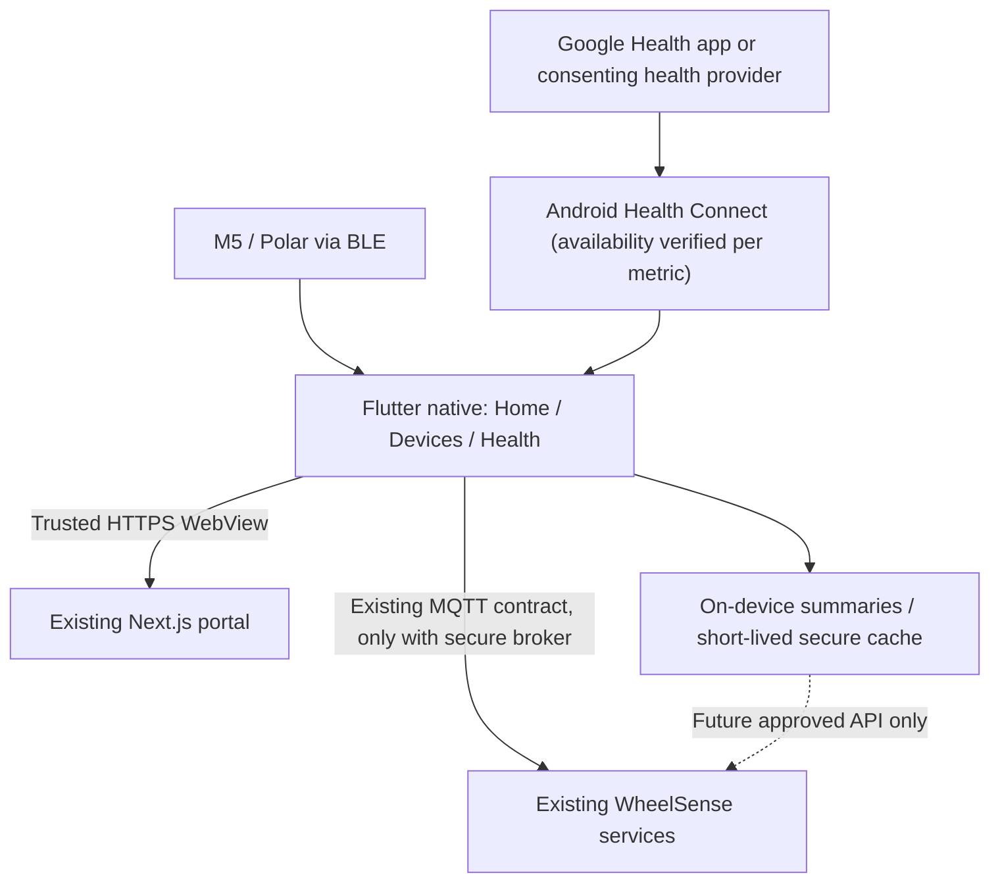

# MOB-01 — Flutter Mobile UX, Existing-Server Connectivity, and Fitbit Insights

**Created:** 2026-10-18  
**Status:** LOCAL FLUTTER IMPLEMENTATION / DEBUG QA COMPLETE — see [verified progress](../mobile-ui-implementation-progress.md); hardware, production deployment and provider gates remain open  
**Goal charter:** [MOB-01](../goals/mobile-app-experience-health.md)  
**Primary implementation root:** `mobile-app/wheelsense-gateway-flutter/`  
**Read-only reference checkout:** `D:\Project\nipoonfitbit` at `c35f76e`

## 1. Guardrails / decisions

- **No change** to `server/`, `frontend/`, `firmware/` or the existing database for this workstream. Any future server and database work is a separately accepted request from the teammate.
- Keep the current Flutter BLE gateway (M5StickC Plus 2 + Polar Verity Sense), MQTT data format, existing patient assignment, and embedded WheelSense portal.
- Enhance Flutter with native mobile UX; reuse the real Next.js portal in WebView for role-based operations. Do not copy its pages into Flutter.
- Use real, authenticated measurements where granted, not fabricated fallbacks. Development fixtures must be visibly labeled **DEMO** and never go to production.
- Fitbit-derived data is **read-only/local by default**. Do not sneak new metrics through existing vitals or MQTT paths unless the server owner explicitly approves semantics.
- Document evidence before claiming a task complete; use existing `flutter test` and `flutter analyze`, focused widget tests, and real-device integration checks.
- Do not commit credentials, OAuth token files, phone identifiers, patient data or copied upstream content without verifying license/provenance.

## 2. Current-state inventory (source audit, not live deployment validation)

| Component | Existing implementation | Concern / direction |
|---|---|---|
| Flutter app | `lib/main.dart` has seven bottom-nav destinations | Consolidate to four mobile-focused destinations; move diagnostics/settings to drill-down |
| BLE | `lib/services/ble_gateway_service.dart` uses Polar SDK and BLE; M5/Polar pairing present | Keep connections working, test real hardware, show accurate connection states |
| Gateway runtime | `lib/services/gateway_runtime_service.dart` and `mqtt_gateway_service.dart` | Preserve topics; add authenticated connection checks, reconnect/error/last-ingested status |
| Configuration | `lib/models/gateway_config.dart` defaults to `broker.emqx.io:1883` and placeholder portal | Safe defaults and explicit provisioned secure endpoint; no real PHI on public broker |
| Preferences | `gateway_preferences_service.dart` serializes config, including MQTT password, into SharedPreferences | Move secrets to platform secure storage, migrate without silent loss |
| Web portal | `portal_webview_screen.dart` and `gateway_webview_service.dart` | Enforce trusted HTTPS navigation, error UX and external OAuth/system browser paths |
| Polar PPG | `ble_gateway_service.dart` estimates SpO2 from PPG; `polar_sensors_card.dart` treats absent contact as true | Experimental estimate must not be clinical/vital evidence; unknown contact is **Unknown** |
| Backend access | Existing FastAPI `/api/health`, `/api/vitals/readings`, MQTT ingestion and Next.js role portal | Existing contracts only; integration depends on secure network, valid identity, patient mapping |
| Fitbit reference | Google Health fetch + Python baselines, trends, sleep analysis; separate React dashboard | Reuse mathematical ideas/test vectors, NOT desktop OAuth credentials, Python local token files or dashboard server |

Current-source caveat: Checked-in Mosquitto config permits anonymous TCP 1883; backend MQTT TLS code previously reviewed disables certificate verification. **Do not treat these as safe production transport.** Ask server owner for a secured deployment; do not change those server files in this workstream.

## 3. Proposed data and screen boundaries

### Mobile-only modules (proposals, add only when needed)

- `lib/screens/health_screen.dart`: read-only historical data and explanation UI.
- `lib/services/health_record_source.dart`: interface returning typed, consented `HealthRecord` objects with `source`, `sourceRecordId`, `metric`, `value`, `unit`, `recordedAtUtc`, `receivedAtUtc`, `isEstimated`, `quality`, `availability`.
- `lib/services/health_connect_source.dart`: Android-only adapter, added after available record types and permissions are proven; avoid premature dependencies.
- `lib/services/health_analytics_service.dart`: small deterministic Dart calculations with golden-vector tests from `nipoonfitbit`. No direct Python runtime on the phone.
- Prefer existing `theme/`, `widgets/`, `services/`, and localizations over new frameworks or state management libraries.

**Never conflate** live Polar heart-rate stream, remote server-stored readings, Health Connect historical aggregates and custom analytics scores. Surface actual measurement source, recency and estimated/experimental flags.

## 4. Phased execution (do not skip gates)

### MOB-0 — Baseline and contract discovery (first)

- [ ] Record baseline `flutter --version`, `flutter pub get`, `flutter analyze`, `flutter test`, Android build/smoke, Git branch and working tree.
- [ ] Verify available local Android toolchain and at least one physical Android test device. If missing, label build/hardware gate **NOT VERIFIED**, not PASS.
- [ ] Screenshot/inspect current seven tabs at narrow/wide layouts; map setup, BLE scans, Gateway runtime, WebView, Thai/English and permission screens.
- [ ] Capture exact existing BLE/MQTT topic/payload/registration/retained-config contract; no breaking additions.
- [ ] Obtain sanitized real server reachability, secure broker details and a non-PHI test identity; confirm existing `/api/health` and portal login before changing settings.
- [ ] Check actual Health Connect access and which metrics were written by Google Health/Fitbit for the test device. Lack of data is a **provider gate**, not a reason to fabricate records.

**Gate:** Baseline and input dependencies recorded; no existing user or teammate files overwritten.

### MOB-1 — Native Flutter UX/UI redesign

- [ ] Replace seven always-visible phone tabs with **Home**, **Devices**, **Health**, **Care Portal**; hide Settings and Radar/Polar diagnostics behind device/detail routes.
- [ ] Implement a single, resumable onboarding sequence: app permission -> configure existing server -> pair M5/Polar -> confirm patient assignment -> optional Health Connect authorization.
- [ ] Reuse Flutter Material app theme, typography, clinical components, localization EN/TH, and existing BLE runtime instead of rewriting device business logic.
- [ ] Make offline, connecting, stale data, permission denied, device absent, no patient link, no health data and demo statuses explicit; never show green readiness based on an optional unpaired Polar.
- [ ] Native Android back behavior, touch targets, readable small-screen content, light/dark theme, accessible semantics, screen reader and large text.
- [ ] Add focused widget/golden tests for navigation and state transitions before replacing screens.

**Gate:** No horizontal overflow at 360/390/430dp, logical navigation and meaningful empty/error states, EN/TH review, existing device flows preserved.

### MOB-2 — Secure connection to the EXISTING WheelSense deployment

- [ ] Keep current MQTT topics and telemetry envelope. Use already provisioned TLS broker/ACL/device identity; **never** send patient payloads to default anonymous `broker.emqx.io:1883`.
- [ ] Separate settings **Portal HTTPS URL**, **API reachability**, **MQTT broker/credentials**; guide non-expert users with provisioning/test result rather than raw developer forms by default.
- [ ] Keep MQTT secrets in Android/iOS platform-secure storage, migrate legacy plain SharedPreferences and clear old secret value without dropping benign preferences.
- [ ] Require valid HTTPS portal URL for remote mode; validate trusted origin, external link handling, navigation and error/offline/reload states.
- [ ] Distinguish Bluetooth-connected, broker-connected, published, broker-acknowledged and **actually ingested**; backend ingest confirmation requires observable existing API/storage evidence, not local QoS alone.
- [ ] Validate reconnect, background service, duplicate upload, timestamps (UTC with local display), rate limiting and consent.
- [ ] Pair/patient assignment cannot override backend RBAC. If no authenticated broker/identity or existing server mapping is available, **BLOCK production live mode** and continue UI/fixture development.

**Gate:** One actual M5/Polar sample is visible against the correct test patient through existing server/web with an authorized secured path; otherwise record precise unresolved dependency.

### MOB-3 — Optional Fitbit / Google Health read-only access

- [ ] Prefer Android **Health Connect** as an isolated, mobile-local read adapter; verify per-record permission and actual Google Health/Fitbit writing/sync on device first. Supported type does NOT guarantee presence.
- [ ] Ask only for necessary read permissions: sleep session/stages, HR, HRV, resting HR, steps, SpO2 and respiratory rate as used. Show explicit "Not shared/Unavailable" for missing type.
- [ ] Capture record origin/source app, device if present, timezone, timestamps, units and provenance; dedupe cross-source overlaps rather than summing identical wearable records.
- [ ] Add an explicit "Connect health data" action, data-access explainer, revoke/disconnect, privacy state; honor Android data-access restrictions/history permission requirements.
- [ ] Do not embed Google OAuth login in WebView or copy `nipoonfitbit` `credentials.json`/`token.json` to the app.
- [ ] Google Health API route is **conditional/deferred** until an approved project/application and secure per-user OAuth ownership are available. The legacy Fitbit Web API is not a new integration path.

**Gate:** Test device yields at least one consented historical record with source/time; otherwise the UI remains usable with clearly unavailable provider states.

### MOB-4 — Fitbit-inspired native charts and explanations

- [ ] Port the **minimal** validated `nipoonfitbit` calculations to pure Dart: 28-day robust personal baseline (median/MAD), HR/HRV/resting HR trends, activity and sleep duration/stages where data exists.
- [ ] Add source-labeled overview cards, sleep hypnogram, 7/28-day trend, freshness and a "why this changed" explanation; confidence derived from coverage and missingness.
- [ ] Use unit tests/golden input-output vectors drawn from documented reference algorithms and edge cases: midnight crossing, sparse periods, timezone, duplicates, missing != zero.
- [ ] Defer opaque composite recovery scores and anomaly/clinical alerts until evidence and behavior are reviewed. All research scores must be labeled non-diagnostic.
- [ ] Do not display Polar's unvalidated PPG-derived SpO2 estimate as certified oxygen saturation or trigger a clinical threshold; unknown skin contact must stay unknown.

**Gate:** Deterministic analytics parity, no fabricated records or confident conclusions from inadequate data.

### MOB-5 — Test and handoff

- [ ] Run `flutter analyze`, `flutter test`, Android release build and test on physical phone after implementation.
- [ ] Verify foreground/background BLE, airplane mode, permission revoked, duplicate events, no network, rotating screen, returning from Google/Health Connect, WebView session and trusted redirects.
- [ ] Test with sanitized sim account and, only after secure provisioning, a real non-PHI patient record end-to-end; include screenshots and a concise reproduction/log sheet.
- [ ] Check secrets/PHI never appear in logs, Git, screenshots; report data provenance, security configuration and graceful failure.
- [ ] Document actual vs NOT VERIFIED gates and handoff info in the MOB-01 charter; do not overwrite firmware-phase progress claims.

**Gate:** Reviewable Flutter code + passing verifiable device/app tests + zero changes to out-of-scope backend/web/firmware.

### MOB-6 — Future backend-owned Fitbit storage (BLOCKED until teammate agrees)

This is a **request draft**, NOT an existing endpoint, schema or approved implementation:

- **Need:** persistent per-patient health history from Fitbit/Google Health, without mixing vendor origin or simulation data with live Polar/M5 telemetry.
- **Owner:** server/database teammate. Mobile workstream may implement a client only after the contract is accepted.
- **Proposed minimum record envelope:** `workspace_id`, `patient_id`, `provider`, `provider_user_id` (separately protected), `external_record_id`, `device_id?`, `metric_type`, `value` or typed payload, `unit`, `observed_at_utc`, `start_at_utc?`, `end_at_utc?`, `ingested_at_utc`, `quality/estimated/provenance`.
- **Suggested API semantics:** authenticated, workspace/patient-scoped connection status, consent/revoke, query historical records, and server-managed secure ingest/sync (exact routes TBD); idempotency on `provider + external_record_id + patient/workspace`; timestamps and source retained.
- **Operational agreement required:** data access ownership, token encryption/rotation, RBAC, rate limits, retention/deletion/export, encryption, migration plan, audit and monitoring. Never route Fitbit samples through an unrelated `/api/vitals/readings` endpoint without explicit schema semantics.
- **Approval gate:** exact API/OpenAPI contract, auth and migration agreed, non-PHI fixture available, negative cross-patient access tests pass, and teammate supplies integration environment.

## 5. Existing-server dependencies to request (no teammate code changes authorized yet)

1. Stable **HTTPS portal** address and a read-only/test-account login or approved mobile auth workflow.
2. Production-safe **TLS MQTT endpoint** or approved authenticated transport for the existing topics, credentials provisioned without committing them, per-device publish/subscribe ACL.
3. A **non-PHI test workspace/patient**, M5/Polar device registrations or supported pairing procedure, expected `device_id`, assignment and workspace-scoped authorization.
4. Confirmation of current `/api/health` and any read-only ingested-telemetry endpoint; existing envelope/topic version and de-duplication behavior.
5. Later only: backend Fitbit sync/storage acceptance, provider access method, schema/API owner, retention/consent policy and sandbox fixtures.

Until items 1–3 are met, build UX and local Health Connect read capability with explicit `DEMO` or `OFFLINE` labeling, and do not claim real server integration succeeded.

## 6. Risk register

| Risk | Mitigation and gate |
|---|---|
| Google Health API does not onboard this new project | Health Connect-first proof; independently verify Google Health app data sharing; optional source stays unavailable |
| Android Health Connect contains no Fitbit records of desired type | Per-metric capability+source matrix on real phone; no fake data |
| User data crosses unsecured MQTT or anonymous broker | Reject live PHI publishing until broker TLS/auth/ACL and server verification are in place |
| Desktop OAuth token copied into mobile | Never port credentials; use Android permission flow or separately approved server OAuth |
| Fitbit vs Polar values confuse caregivers | Source + timestamp + estimated marker on every metric; no clinical alerts on experimental estimates |
| SharedPreferences leaks broker credentials | Platform secure storage; migrate/wipe old secret only after verified save |
| Server changes violate teammate ownership | Only Flutter and .project edits; backend modifications blocked and separately approved |
| Phone kills BLE service or records upload twice | Background/reconnect/device soak; dedup and confirmed-ingest acceptance |
| Role-bearing WebView follows untrusted URL | Strict allowed origins, external browser for OAuth/untrusted links, preserve existing site auth |

## 7. Evidence and scope check for future implementation

For each phase: record Git diff paths, Flutter commands and exit codes, device model/OS version, screenshots (sanitized), actual measured data vs fixture, unresolved blockers, regression pass/fail, and acceptance sign-off. **No implementation milestone is marked done merely because this plan exists.**

Before making a mobile commit, verify `git diff --name-only` only includes `mobile-app/wheelsense-gateway-flutter/**` and its intended `.project/**` documentation. If anything under `server/`, `frontend/` or `firmware/` appears, stop and investigate.

### Public documentation verified 2026-10-18

- Android Health Connect data types/permissions: https://developer.android.com/health-and-fitness/health-connect/data-types
- Google Health app and Health Connect integration: https://support.google.com/googlehealth/answer/14506680
- Google Health API availability and legacy Fitbit Web API shutdown (2026-10-30): https://developers.google.com/health/about
- Google Health OAuth migration: https://developers.google.com/health/migration
